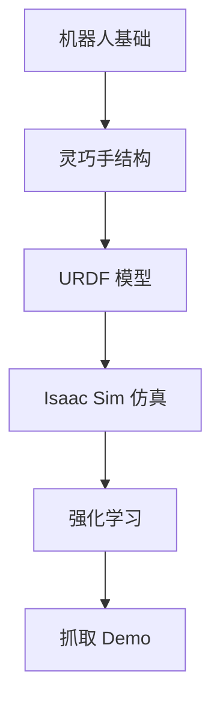
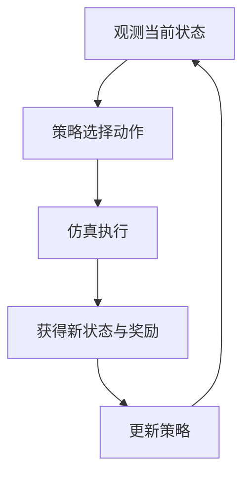

# 从机器人基础到灵巧手学习笔记

**第一节：理解自由度、驱动方式与控制难点**

学习这节课的重点，是把机器人的机械结构、可控动作与抓取任务联系起来。自由度增加通常能拓展动作能力，但稳定抓取还取决于驱动方式、接触条件和控制策略。

本笔记依据 Xbotics 与灵心巧手训练营的《从机器人基础到灵巧手》20 页课件整理。[课程页面](https://appqpvv4xwu6898.h5.xiaoeknow.com/p/course/video/v_6ae5a0d1e4b023c0863aa2f0?product_id=course_3LS26013Esm5rpxdKXfBPwERHXx&course_id=course_3LS26013Esm5rpxdKXfBPwERHXx&sub_course_id=)

文中的页码对应原 PPT；标为 **理解补充** 或 **练习** 的内容用于辅助理解。O6、L20 的型号说明保留了课件与厂家资料之间的口径差异，详见[第 6 节](#actuation)。

## 目录

- [1. 学习路线与本节目标](#learning-path)
- [2. 关节数、自由度与驱动数](#degrees-of-freedom)
- [3. 关节空间与笛卡尔空间](#motion-spaces)
- [4. 位置、速度与力矩控制](#control-modes)
- [5. 灵巧手的能力与控制难点](#dexterous-hands)
- [6. 欠驱动、全驱动与机械耦合](#actuation)
- [7. URDF、仿真与强化学习如何衔接](#simulation-and-learning)
- [8. 用抓杯子串联整节课](#grasping-example)
- [9. 复习与自测](#review)
- [补充来源](#references)

## 1. 学习路线与本节目标

> 对应课件第 2–3 页。

本节先掌握结构和控制语言，再理解后面的建模与训练。学完后，应能：

- [ ] 解释自由度，并区分关节数、自由度与驱动数。
- [ ] 区分关节空间与笛卡尔空间。
- [ ] 比较普通夹爪与灵巧手的能力和代价。
- [ ] 说明不同驱动方案的取舍。
- [ ] 说清 URDF、Isaac Sim 与强化学习各自解决什么问题。

## 2. 关节数、自由度与驱动数

> 对应课件第 4、6 页。

| 概念 | 核心含义 | 判断时要问什么 |
| --- | --- | --- |
| 关节数 Joint | 机械连接中可发生相对运动的关节数量 | 有哪些关节连接了哪些部件 |
| 自由度 DoF | 描述系统构型所需的独立运动变量数 | 考虑约束后有多少变量能独立变化 |
| 驱动数 Act | 主动执行器数量；另需区分独立控制输入数 | 有多少执行器和可独立下发的命令 |

课件例子：滑块只能沿一个方向平移，是 1 个自由度；若机械臂的 6 个转动关节相互独立，则有 6 个关节自由度。普通联动夹爪虽然两侧爪指都在动，开合通常只需要 1 个独立变量。

**O6 示例：**课件强调控制通道较少、部分关节通过连杆联动。不能把机械关节数量直接记成独立自由度；要继续看机构约束和实际控制接口。课件与厂家型号参数的口径差异见[第 6 节](#actuation)。

**记忆要点：**关节数看结构，自由度看独立运动，驱动数看主动输入。三者不能直接画等号。

## 3. 关节空间与笛卡尔空间

> 对应课件第 7–9 页。

### 关节空间描述机器人自身状态

关节空间（Joint Space）以关节变量描述机器人。例如，手指三个关节分别处于 20°、40°、30°。同一组关节也可以讨论对应的速度；移动关节则用直线位移描述位置。

记住它回答的问题：“每个关节分别转了多少，或正在以多快的速度运动？”实际使用时还应区分模型中的全部关节状态与控制器接收的独立指令。

### 笛卡尔空间描述位置和姿态

笛卡尔空间（Cartesian Space）用于描述指尖、手掌或物体的空间位置与姿态。课件用位置 x、y、z，以及姿态 roll、pitch、yaw 帮助理解。

**理解补充：**位置和姿态必须说明相对于哪个坐标系，例如世界坐标系、手掌坐标系。两个坐标系中的同一组数字，通常不代表同一个位置。

| 比较项 | 关节空间 | 笛卡尔空间 |
| --- | --- | --- |
| 关注对象 | 关节的状态 | 物体、指尖、手掌的位姿 |
| 常见表达 | 各关节角度、位移或速度 | 三维位置与姿态 |
| 典型提问 | 食指第二关节转多少度 | 指尖应到杯子哪一侧 |
| 主要用途 | 描述关节状态与控制目标 | 描述抓取或操作的任务目标 |

### 用抓杯子把两个空间联系起来

先在笛卡尔空间描述任务：杯子在哪里，手掌从哪个方向接近，指尖希望接触杯子的哪些位置。随后求出或生成相应的关节目标，再由控制器执行。

**理解补充：**正运动学把关节构型映射为指尖或末端位姿；逆运动学根据目标位姿寻找满足要求的关节构型。逆运动学可能有多解，也可能因关节限位或可达范围而无解。

**易错点：**“知道杯子在哪里”只确定了任务的一部分。机器人还要解决姿态、可达性、碰撞与手指接触顺序等问题。

### 随手练习

把下面两句话分类：“食指转到 30°”属于关节空间；“指尖靠近杯壁右侧”属于笛卡尔空间。继续追问第二句话：右侧是相对于哪个坐标系？

## 4. 位置、速度与力矩控制

> 对应课件第 10 页。

三种控制方式的区别在于给控制器下发什么目标。任务中看到的手指动作，可以由不同层级的控制器实现。

| 控制方式 | 下发的目标 | 例子与学习重点 |
| --- | --- | --- |
| 位置控制 | 目标角度或目标位移 | 食指关节到 30°；先学会让关节到达指定姿态 |
| 速度控制 | 目标角速度或线速度 | 让手指以给定速度闭合；关注运动方向与快慢 |
| 力矩控制 | 目标关节力矩 | 调节转动关节施加的力矩；关注动力学与接触交互 |

### 初学者为什么先学位置控制

位置目标最直观：给定一个角度，观察关节是否到达。它便于建立“控制输入—手指姿态”的对应关系，也适合先完成张开、闭合、简单手势等任务。

**理解补充：**位置控制器也会通过执行器产生作用力。这里的分类指对外提供的命令接口，不能据此认为位置控制过程中没有力或力矩。

### 关节力矩与接触力要分清

转动关节的力矩通常用 N·m 表示，指尖接触力用 N 表示。给定某个关节力矩，并不等于直接指定相同数值的指尖接触力；两者的关系受到手指姿态、接触点和传动结构等因素影响。（[补充来源 2][2]）

课件把力矩控制与“用合适力度抓杯子”联系起来，是为了说明它在接触任务中的作用。更准确的理解是：关节力矩是调节接触作用的一条途径，稳定抓取仍需考虑反馈、摩擦与物体运动。

### 抓杯子各阶段关注什么

1. **接近**：让手掌和手指到达合适的预抓取姿态。
2. **闭合**：调节手指运动，逐步建立接触。
3. **保持**：判断物体是否稳定，是否需要调整动作。

上述阶段并不要求分别只能使用某一种控制方式。

### 判断题

“位置目标已经到达，所以杯子一定抓稳了。”这句话不成立。关节到位不能单独证明物体没有滑动，也不能证明接触方式合适。

**本节记忆：**位置控制管目标状态，速度控制管运动快慢，力矩控制管关节施加的转动作用。

## 5. 灵巧手的能力与控制难点

> 对应课件第 5、11–13 页。

### 灵巧手与普通夹爪

灵巧手是一类具有多指、多关节结构的机器人末端执行器。课件强调，它除了夹持物体，还可以通过多指配合调整物体姿态，完成捏、握或更复杂的操作。

| 比较项 | 普通夹爪 | 灵巧手 |
| --- | --- | --- |
| 典型动作 | 开合与夹持 | 多指抓捏、握持与姿态调整 |
| 可控运动 | 通常较少 | 通常较多，需结合机构判断 |
| 结构与控制 | 一般较简单 | 一般较复杂 |
| 任务适配 | 固定工况中的重复夹取 | 需要多指配合或手内调整的任务 |
| 选择重点 | 稳定性、成本与易用性 | 动作能力、接触控制与任务收益 |

课件中“夹爪 1–2 自由度、灵巧手 6–20+ 自由度”是典型范围示意，不是分类的硬性标准。多指也不必然等于所有关节都能独立控制。

### 自由度增加带来的取舍

更多独立运动变量能拓展可实现的姿态和动作，但控制维度、动作规划、建模与训练成本也可能提高。能力上限提升，不代表每项具体抓取任务都会更容易或更可靠。

### 灵巧操作困难的四个来源

1. **高维运动**：多个关节需要协调，关节之间还有限位、耦合和碰撞约束。

2. **复杂接触**：不同手指和指节可能同时接触物体，接触力、摩擦和滑动相互影响。

3. **物体差异**：形状、尺寸、重量、材质和摩擦条件改变，同一套动作未必仍然有效。

4. **策略设计**：必须决定何时接近、哪些手指先动、接触后如何调整，以及出现滑动时如何恢复。

**学习上的判断：**若任务只要求稳定重复夹取，简单夹爪可能已经合适；若任务需要复杂多指配合或手内操作，灵巧手的更多控制能力才更有价值。

## 6. 欠驱动、全驱动与机械耦合

> 对应课件第 6、14–17 页。

课件用 O6 与 L20 比较不同主动控制维度。学习时应把“欠驱动与全驱动的概念”同“某个产品的具体结构”区分开来。

### 先区分两个判断维度

机械耦合描述关节之间是否存在固定或受约束的运动关系。例如，一个驱动输入带动多个关节时，通常不能随意分别指定这些关节的角度。

**理解补充：**全驱动意味着具备对全部独立运动自由度施加独立控制所需的驱动能力；欠驱动则不具备这种完整能力。判断时要考虑自由度和驱动输入映射，不能只比较电机数与可见关节数。（[补充来源 1][1]）

| 比较项 | 控制输入较少的联动方案 | 独立控制维度更多的方案 |
| --- | --- | --- |
| 关节独立性 | 部分关节角度不能单独指定 | 更多主要关节可分别设置目标 |
| 学习重点 | 输入如何带动多个关节 | 多关节如何协调完成任务 |
| 动作表达 | 受机构联动关系限制 | 通常支持更丰富的组合 |
| 典型代价 | 指令较少，仍需建模被动运动 | 协调关系与策略动作维度更多 |

### O6 与 L20 型号信息如何理解

课件把 O6 写为“10 个机械关节、6 个驱动器”，并将 L20 作为全驱动代表。厂家页面在 2026 年 11 月 8 日核对时分别标注为：O6 有 6 个主动自由度与 5 个被动自由度；L20 有 16 个主动自由度与 5 个被动自由度，均采用连杆传动。（[O6 官方资料][4]、[L20 官方资料][5]）

这些口径不能直接等同。学习时保留“主动控制维度不同”的比较；实训参数以所用版本的手册和 URDF 为准，不能把 L20 的型号名理解为 20 个全独立控制输入，也不能把厂商的主动与被动计数简单相加当作机构独立自由度。

**理解补充：**刚性联动本身不保证接触后能被动贴合物体；输入较少也不保证仿真与训练一定更容易，被动动力学和接触仍可能很复杂。

**课件列举的其他案例：**Pisa/IIT SoftHand、Yale OpenHand Model O、Shadow Dexterous Hand、Wonik Allegro Hand。这里用于认识不同机构路线，先不把型号数字当作本节背诵重点。

## 7. URDF、仿真与强化学习如何衔接

> 对应课件第 2、18–19 页。

| 环节 | 主要解决的问题 | 学习时应看到的结果 |
| --- | --- | --- |
| URDF | 机器人有哪些部件，部件如何连接 | 可识别的 `link`、`joint`、关节限位与几何模型 |
| Isaac Sim | 模型如何在带有物理交互的场景中运动 | 机器人导入、动作可视化、与物体发生接触 |
| 强化学习 RL | 如何从状态和反馈中学习动作策略 | 策略根据观测选择动作，并通过奖励优化 |

### URDF 是结构描述的起点

`link` 表示刚体部件，`joint` 描述部件之间的连接及允许运动；模型还涉及视觉几何、碰撞几何、质量与惯性等信息。之后的仿真依赖这些描述来构建机器人。

**理解补充：**URDF 不是完整控制器。简单关节联动可用 `mimic` 描述；主动与被动关系能否在仿真中正确实现，还取决于导入器、控制接口以及驱动和约束配置。不能认为导入文件后全部自动正确。（[补充来源 3][3]）

### Isaac Sim 把结构放进任务场景

学习时依次观察：模型是否正确显示，关节运动方向和限位是否合理，碰撞与接触是否符合预期，场景中的物体、相机和传感器是否满足任务需要。先把基础动作跑通，再考虑训练。

### 理解补充 强化学习的基本循环

观测当前状态 → 策略选择动作 → 仿真执行 → 获得新状态与奖励 → 更新策略 → 继续尝试。

用抓杯子作概念示例：观测可以包含关节状态与杯子位姿；动作可以是关节位置目标、速度目标或力矩命令；奖励可以围绕接近、稳定握持与保持目标姿态设计。这些是理解示例，并非课件已经提供的训练配置。

强化学习并不省去任务设计。人仍需定义观测、动作、奖励和训练场景；训练效果也依赖模型与物理交互是否可信。它是处理复杂策略的一条路线，并非所有抓取任务都必须使用的方法。

### 本节与下一节的衔接

读 URDF 时，带着三个问题：哪些是机械关节，哪些状态相互独立，哪些输入由执行器主动控制。这样才能把本节概念与仿真中的机器人对应起来。

## 8. 用抓杯子串联整节课

> 对应课件第 7–10、13、18–19 页。

下面是依据本节概念设计的理解练习，用来把“结构、空间、控制和反馈”连起来。它不是课件已经运行验证的实验步骤。

### 第一步 把任务目标说清楚

目标可以表述为：手指接近杯子，建立合适接触，并在指定动作中保持杯子稳定。杯子位置、手掌朝向与预期接触点属于笛卡尔空间层面的任务描述；同时应明确使用的坐标系。

### 第二步 识别实际能控制什么

列出可下发指令的驱动通道，检查哪些关节会联动。对于 O6 代表的方案，不能默认能单独设置全部机械关节；对于更独立的多关节方案，则需要安排更多关节之间的协调。

### 第三步 先完成不接触物体的动作

用位置目标建立张开、预抓取、闭合三种姿态，观察运动方向与限位是否正确。重点是弄清控制输入与手指动作的对应关系，不急于把“手指能动”判成“能抓稳”。

### 第四步 观察接触后的变化

手指碰到杯子后，物体可能移动、转动或滑动。此时既要观察关节状态，也要观察杯子位姿和接触情况。同样的关节目标，在不同物体和摩擦条件下可能产生不同结果。

### 第五步 区分失败发生在哪一层

| 观察到的现象 | 优先思考的问题 |
| --- | --- |
| 指尖靠近了错误的位置 | 坐标系、目标位姿或运动映射是否有误 |
| 多个关节无法按预期分别运动 | 是否存在机械耦合，或混淆了状态与控制通道 |
| 关节到位但杯子仍滑动 | 接触布局、摩擦和夹持作用是否合适 |
| 换一个物体后动作失效 | 策略是否只适应特定形状、尺寸或物理条件 |

### 无需硬件也能完成的小练习

画一只由两个关节组成的手指。情况 A：两个关节各有独立驱动；情况 B：一个驱动通过刚性连杆让它们按固定关系运动。比较两种情况能否任意指定两个角度，并解释为什么“看得见两个关节”不等于“有两个独立自由度”。

## 9. 复习与自测

> 对应课件第 3、19 页。

### 先记住这六句话

1. 关节数看机械结构，自由度看独立运动变量，驱动数看执行器和输入。
2. 关节空间描述自身状态，笛卡尔空间描述任务中的位置与姿态。
3. 位置、速度和力矩控制，按下发目标区分。
4. 灵巧手增加了动作可能性，也增加了协调与接触控制的难度。
5. 联动方案减少独立指令，独立控制方案提供更细动作能力；具体取舍看任务。
6. URDF 描述结构，仿真提供交互环境，强化学习优化动作策略。

### 自测题与参考答案

**1. 有 10 个关节和 6 个电机，就一定有 10 个独立自由度吗？**

展开参考答案

不能。要检查机械约束、联动关系及独立运动变量；关节数不能直接当作自由度。

**2. 指尖坐标是 x、y、z，这个描述完整吗？**

展开参考答案

还需要坐标系；若任务要求控制朝向，还应描述姿态。

**3. 位置目标达到，能否证明物体已抓稳？**

展开参考答案

不能。还要检查接触、物体运动或滑动等状态。

**4. 欠驱动能否简单理解为“电机比关节少”？**

展开参考答案

课件这样帮助入门；严格判断还要比较独立驱动输入与独立自由度，并分析机构约束。

**5. 为什么全驱动方案更适合某些复杂操作，却可能更难训练？**

展开参考答案

更多主要关节能独立调节，动作表达更丰富；但策略也要处理更多协调关系和更高维的动作。

**6. 为什么不能只学强化学习，跳过结构和仿真？**

展开参考答案

策略的动作含义、可达范围与物理反馈都依赖模型和环境；结构或接触配置错误会影响学习结果。

### 回看课件的定位索引

| 主题 | 原 PPT 页码 |
| --- | --- |
| 自由度与三种数量 | 4–6 |
| 运动空间 | 7–9 |
| 控制方式 | 10 |
| 灵巧手能力与难点 | 11–13 |
| 型号与驱动方案 | 14–17 |
| 工具链与总结 | 18–19 |

## 补充来源

1. [MIT Underactuated Robotics：全驱动与欠驱动定义][1]
2. [Modern Robotics 11.5：关节力矩与末端力控制][2]
3. [ROS 官方 Joint Kinematics：关节自由度与 mimic][3]
4. [Linker Hand O6 官方产品页][4]
5. [Linker Hand L20 官方产品页][5]

产品页面核对日期：2026 年 11 月 8 日。型号参数以实际使用版本的手册和模型为准。

[1]: https://underactuated.mit.edu/intro.html
[2]: https://modernrobotics.northwestern.edu/nu-gm-book-resource/11-5-force-control/
[3]: https://control.ros.org/jazzy/doc/ros2_control/hardware_interface/doc/joints_userdoc.html
[4]: https://linkerhand.com/details/LinkerHandO6/
[5]: https://www.linkerhand.com/details/LinkerHandL20/
